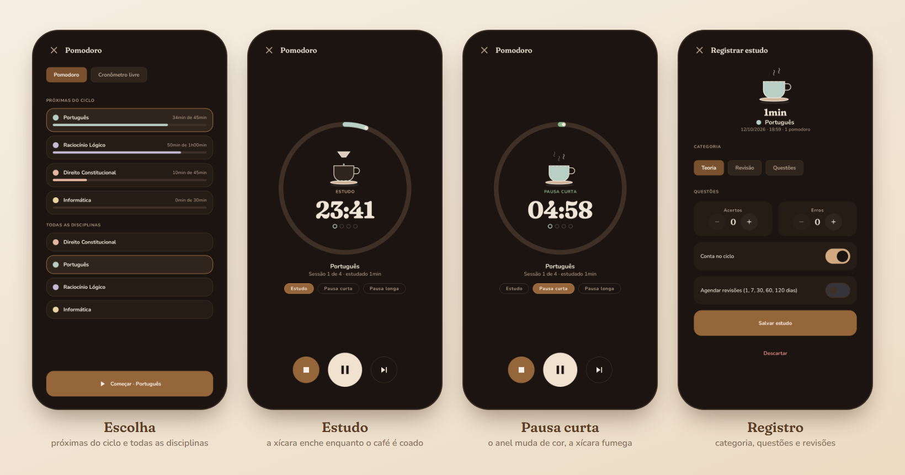
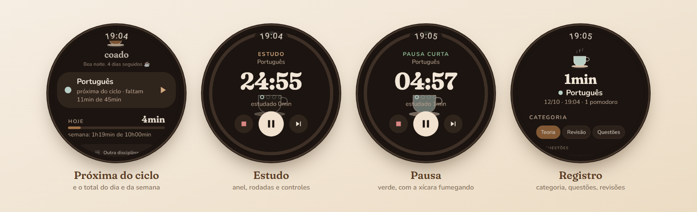

# Coado no celular e no pulso





Dois apps Android com o mesmo pacote (`br.app.coado`), num projeto Gradle só:

| Módulo | O que é |
| --- | --- |
| `phone` | O Coado no celular: login com o Google nativo, o **site inteiro** numa WebView já logada (planos, edital, ciclo, revisões, estatísticas, simulados, arquivos…), o **pomodoro nativo** (sobrevive em segundo plano, notificação com pausar/pular/finalizar) e a ponte com o relógio. |
| `watch` | O Coado no Wear OS, focado no pomodoro: próxima sessão do ciclo, timer com a xícara sendo coada, registro do estudo (categoria, questões, revisões), progresso do ciclo, constância e meta da semana. |
| `shared` | O que os dois têm em comum: modelo da api, as contas do site (ciclo, constância) portadas, o motor do timer, a sincronização, o tema café/lofi e as ilustrações. |

```
   site (WebView)           api                       relógio
┌────────────────┐   Bearer  ┌───────────┐  Data Layer  ┌──────────────┐
│ celular        │◄─────────►│ /api/...  │              │ pomodoro     │
│ · login Google │           └───────────┘              │ · ciclo      │
│ · pomodoro     │◄──────── /coado/snapshot ───────────►│ · registro   │
│ · ponte        │◄──────── /coado/study/<id> ──────────│ · progresso  │
└────────────────┘                                      └──────────────┘
```

## Como a conta chega aos aparelhos

- **Celular.** O Sign in with Google (Credential Manager) entrega um `id_token` no aparelho; a api o valida (`POST /api/auth/google/token`) e abre uma *sessão de aparelho* (token Bearer, 1 ano, aparece em Perfil → "Onde você está conectado"). Para a WebView, o app carrega `GET /api/auth/web-session` com o Bearer: a api abre uma sessão web comum (cookie) e redireciona para o site. O site reconhece o app por `window.CoadoNative` e manda o botão de iniciar estudo para o pomodoro nativo.
- **Relógio, pelo celular (padrão).** O celular publica um recorte da conta (`/api/watch/snapshot`: plano ativo, disciplinas, ciclo e progresso, durações, constância) como item de dados do Wear OS. O relógio registra estudos como itens `/coado/study/<id>`; o celular sobe, apaga o item e republica o recorte. Itens de dados ficam guardados: um estudo registrado sem o celular por perto sobe assim que ele aparecer.
- **Relógio, direto.** Sem celular, Ajustes → Conta → *Direto* e o código de **Configurações → Relógio** do site (`POST /api/watch/pair`).

## Energia

Nada conta segundos em segundo plano. O estado do timer são carimbos de tempo; o fim de cada etapa é um alarme exato (`setExactAndAllowWhileIdle`) que acorda o processo só para vibrar e passar à etapa seguinte. A notificação da sessão usa o cronômetro do sistema (no relógio, a *atividade em andamento* com `TimerPart`): o chip no mostrador conta sozinho. Com a tela acesa há um tique por segundo; no modo ambiente o relógio mostra um quadro parado (contornos, preto, uma atualização por minuto, deslocamento contra marcação). Vapor e café pingando só rodam com a tela acesa e as animações ligadas (Ajustes). A sincronização é em lote, pelo WorkManager, com rede.

## Compilar e instalar

Pré-requisitos: JDK 17+ (o do Android Studio serve), Android SDK com a plataforma 37.

```sh
cd apps/android
./gradlew :shared:testDebugUnitTest :phone:assembleDebug :watch:assembleDebug
adb -s <celular>  install -r phone/build/outputs/apk/debug/phone-debug.apk
adb -s <relógio>  install -r watch/build/outputs/apk/debug/watch-debug.apk
```

O build `debug` fala `http` e aponta para `http://10.0.2.2:5173` (o `npm run dev` do monorepo, visto do emulador); `-Pcoado.server=http://192.168.0.10:5173` troca esse endereço na compilação. Em `release`, o servidor é `https://coado.app.br`; o endereço também pode ser trocado na tela de entrada do celular ("Outro servidor") e nos Ajustes do relógio.

Para o emulador enxergar o Vite, suba o front ouvindo em todas as interfaces (no Windows, `localhost` fica só no IPv6, que o emulador não alcança):

```sh
npm run dev -w @coado/api
npm run dev -w @coado/web -- --host 0.0.0.0
```

### Login com o Google no celular

Além do *ID do cliente OAuth* **Aplicativo da Web** que a api já usa (`GOOGLE_CLIENT_ID`), crie no mesmo projeto do Google Cloud um cliente do tipo **Android** com o pacote `br.app.coado` e o SHA-1 da chave que assina o app (`./gradlew :phone:signingReport`). O app pede o `id_token` com o client id web (a api o informa em `/api/auth/config`), e a audiência bate com a validação que o site já faz. Sem Google Play Services (emulador sem Google APIs), o botão **Entrar como visitante** aparece quando a api está com `AUTH_DEV_LOGIN=true`.

### Aparelhos reais (depuração sem fio)

```sh
adb pair <ip>:<porta do pareamento> <código de 6 dígitos>   # uma vez
adb connect <ip>:<porta da tela principal da depuração sem fio>
adb -s <celular> reverse tcp:5173 tcp:5173                   # se o celular não alcança o computador
adb -s <celular> shell am start -n br.app.coado/br.app.coado.phone.MainActivity --es servidor http://127.0.0.1:5173
```

O relógio não precisa de nada disso: ele recebe a conta pelo celular pareado (Data Layer). O túnel do `adb reverse`
vale enquanto o adb estiver conectado; para uso no dia a dia, o servidor precisa ser alcançável pela rede do
celular (um host público ou uma VPN como o Tailscale).

### Relógio no emulador

O AVD de Wear OS alcança o computador por `10.0.2.2`. Para testar o pomodoro sem celular, use a conexão direta:

```sh
adb shell am start -n br.app.coado/br.app.coado.watch.MainActivity --es servidor http://10.0.2.2:5173 --es codigo 123456
```

(o código vem de Configurações → Relógio no site). Para a ponte com o celular, os dois apps precisam estar pareados pelo app Wear OS do celular, com a mesma assinatura (os dois builds `debug` usam a mesma chave de depuração).

## Diagnóstico

```sh
adb logcat -s CoadoTimer CoadoSync CoadoWear CoadoPhone CoadoWatch
```
